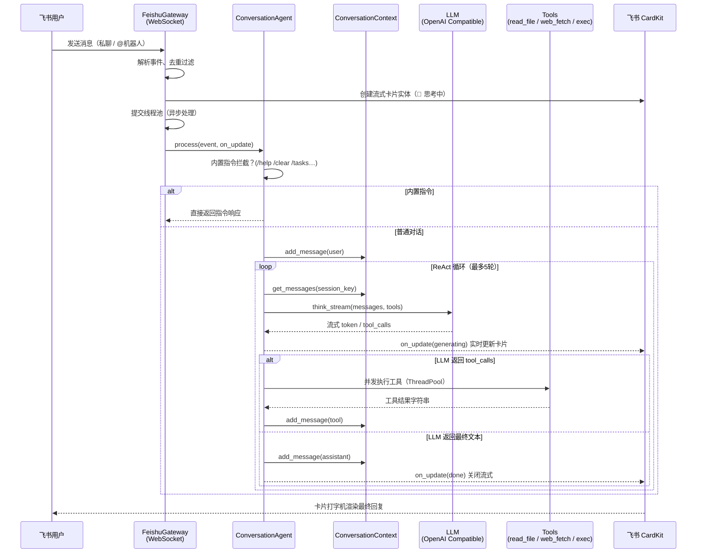
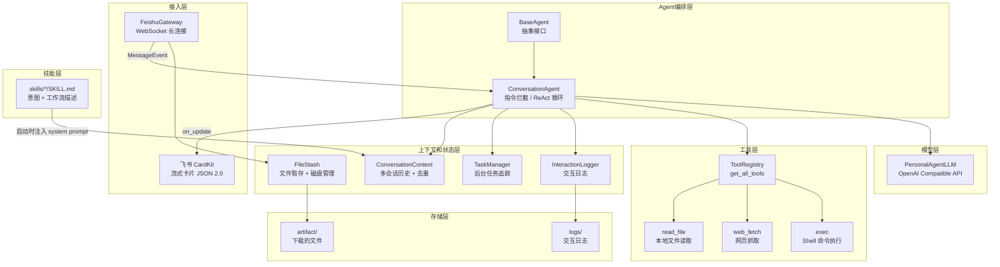

# PersonalAgent

基于飞书平台的个人 AI 助理机器人，通过 WebSocket 长连接接收消息，调用 OpenAI Compatible API 驱动大语言模型，支持多会话上下文、流式卡片 UI、文件处理、Shell 命令执行与可扩展技能系统。


---

## 项目介绍

### 核心能力

- **多会话管理**：私聊、群聊、话题三维隔离，每个维度独立维护上下文历史（滑动窗口，默认 20 条）
- **流式卡片 UI**：集成飞书 CardKit JSON 2.0，回复以打字机动画逐字渲染，标题实时反映"思考中 → 生成中 → 完成/出错"
- **工具调用（ReAct 循环）**：LLM 可主动调用 `read_file`、`web_fetch`、`exec` 三个工具，最多循环 5 轮直至得出最终回答
- **Shell 执行与后台通知**：`exec` 工具支持前台返回和后台执行，长任务完成后主动推飞书消息通知
- **文件处理**：接收飞书上传的文件（xlsx/csv/txt/pdf 等），下载到本地 `artifact/` 目录，通过文件路径注入 LLM 上下文
- **可扩展技能系统**：在 `skills/` 目录新建 `SKILL.md` 即可热加载技能，系统自动注入到 system prompt，LLM 匹配意图后按工作流执行

### 业务架构



### 技术架构

#### 技术栈

| 分类 | 技术 | 用途 |
|------|------|------|
| 包管理 | uv | 依赖与虚拟环境管理 |
| 运行时 | Python 3.12 | 语言运行时 |
| LLM 接入 | openai SDK（≥ 2.32.0） | OpenAI Compatible API 调用，支持流式与工具调用 |
| 飞书平台 | lark-oapi（≥ 1.5.3） | WebSocket 长连接、消息收发、CardKit 流式卡片 |
| 网页抓取 | requests + markdownify + beautifulsoup4 | `web_fetch` 工具：HTML → 纯净 Markdown |
| 文件解析 | openpyxl | Excel 文件处理 |
| 配置管理 | python-dotenv | `.env` 环境变量加载 |
| 加密 | pycryptodome | 飞书 SDK 内部依赖 |

#### 系统架构图



#### 目录结构

```
PersonalAgent/
├── main.py                          # 启动入口，按依赖顺序初始化所有组件
├── pyproject.toml                   # 项目元信息与依赖声明
├── .env                             # 环境变量配置（需自行填写密钥）
├── AGENTS.md                        # Agent 行为约束，启动时注入 system prompt
├── artifact/                        # 飞书文件下载落地目录（按扩展名分子目录）
├── logs/                            # 交互日志目录
└── personal_agent/
    ├── agents/
    │   ├── base_agent.py            # Agent 抽象基类（定义 process() 接口）
    │   └── conversation_agent.py    # 核心对话 Agent，ReAct 循环与内置指令
    ├── context/
    │   └── conversation_context.py  # 多会话上下文管理，消息去重，滑动窗口
    ├── core/
    │   ├── llm.py                   # PersonalAgentLLM：流式 + 工具调用封装
    │   ├── task_manager.py          # 后台任务生命周期追踪（/tasks 指令数据源）
    │   ├── file_stash.py            # 文件暂存、超时提醒与磁盘清理
    │   ├── interaction_logger.py    # 完整调用链日志（用户→LLM→工具→最终回复）
    │   └── setup_wizard.py          # 首次运行飞书凭证配置向导
    ├── gateway/
    │   └── feishu_gateway.py        # 飞书接入层：WebSocket、CardKit、事件解析
    ├── tools/
    │   ├── registry.py              # 工具注册表（get_all_tools / get_tools_openai_schema）
    │   ├── types.py                 # ToolDef 数据结构
    │   ├── read_file_tool.py        # read_file：读取本地文本文件
    │   ├── web_fetch_tool.py        # web_fetch：抓取网页转 Markdown
    │   └── exec_tool.py             # exec：Shell 命令执行（前台/后台）
    └── skills/
        └── cost-export/             # 内置技能示例：从 MABAN 导出采购成本
            ├── SKILL.md             # 技能意图描述与工作流（系统自动加载）
            └── scripts/             # 技能执行脚本
                ├── mcontroller.py
                ├── cost.py
                └── export.py
```

---

## 项目使用

### 环境要求

- **Python**：3.12（见 `.python-version`）
- **uv**：≥ 0.4（[安装指引](https://docs.astral.sh/uv/getting-started/installation/)）
- **飞书自建应用**：需在[飞书开放平台](https://open.feishu.cn/app)创建应用，开启 WebSocket 长连接与以下权限：
  - `im:message`（接收消息）
  - `im:message:send_as_bot`（发送消息）
  - `cardkit:card`（创建/更新 CardKit 卡片）
  - `im:resource`（下载文件资源，如需文件处理功能）

### 安装

```bash
# 安装 uv（如未安装）
curl -LsSf https://astral.sh/uv/install.sh | sh

# 克隆项目
git clone <repo-url>
cd PersonalAgent

# 同步依赖（uv 自动创建 .venv 并安装）
uv sync
```

### 配置

编辑项目根目录的 `.env`，填入真实值：

```dotenv
# ── LLM 配置（必填）────────────────────────────────────────
# 模型 ID，例如：deepseek-chat / qwen-plus / gpt-4o
LLM_MODEL_ID=deepseek-chat

# API 密钥，从对应平台控制台获取
LLM_API_KEY=your-api-key

# OpenAI Compatible 服务地址
# DeepSeek:   https://api.deepseek.com/v1
# 通义千问:    https://dashscope.aliyuncs.com/compatible-mode/v1
# 硅基流动:    https://api.siliconflow.cn/v1
# OpenAI:     https://api.openai.com/v1
LLM_BASE_URL=https://api.deepseek.com/v1

# 请求超时（秒）
LLM_TIMEOUT=120

# ── 飞书应用配置（必填）────────────────────────────────────
# 飞书开放平台 → 应用详情 → 凭证与基础信息
FEISHU_APP_ID=your-app-id
FEISHU_APP_SECRET=your-app-secret

# 消息并发处理线程数（默认 10）
FEISHU_MAX_WORKERS=10

# ── 日志（选填）────────────────────────────────────────────
LOG_LEVEL=INFO   # DEBUG / INFO / WARNING / ERROR

# ── 飞书卡片流式渲染（选填）────────────────────────────────
FEISHU_STREAM_PRINT_FREQ_MS=10      # 打字机帧率（毫秒）
FEISHU_STREAM_PRINT_STEP=1          # 每帧显示字符数
FEISHU_STREAM_PRINT_STRATEGY=fast   # 渲染策略

# ── 文件暂存（选填）────────────────────────────────────────
FILE_STASH_REMIND_DELAY=180    # 提醒用户说明意图的等待时间（秒）
FILE_STASH_EXPIRE_DELAY=300    # 文件暂存过期时间（秒）
FILE_STASH_DISK_TTL=86400      # 磁盘文件保留时间（秒）
```

可通过 `AGENT_SYSTEM_PROMPT` 环境变量追加自定义系统提示词；`AGENTS.md` 中的「处理原则」章节也会在启动时自动注入。

### 运行

```bash
uv run main.py
```

首次运行若未检测到飞书凭证，会自动启动交互式配置向导。启动成功后通过 WebSocket 与飞书保持长连接，向机器人发送 `/help` 查看所有内置指令。

---

## 内置指令参考

| 指令 | 说明 |
|------|------|
| `/help` | 显示所有可用内置指令 |
| `/clear` | 清空当前会话历史，重新开始对话 |
| `/status` | 查看当前会话状态（历史条数、任务数等） |
| `/resume` | 列出所有历史会话；`/resume <序号>` 恢复指定会话 |
| `/export` | 导出当前会话的完整对话记录（Markdown 格式） |
| `/tasks` | 查看后台任务处理状态（运行中 / 完成 / 失败） |

---

## 扩展开发

### 新增一个 Tool

工具定义位于 `personal_agent/tools/`，注册入口为 `personal_agent/tools/registry.py`。

**第一步：创建工具文件**

```python
# personal_agent/tools/my_tool.py
from .types import ToolDef

def build_my_tool() -> ToolDef:
    def my_call(param: str, **kwargs) -> str:
        return f"结果：{param}"

    return ToolDef(
        name="my_tool",
        description="工具用途描述，LLM 依据此决定何时调用",
        parameters={
            "type": "object",
            "properties": {
                "param": {"type": "string", "description": "参数说明"}
            },
            "required": ["param"],
            "additionalProperties": False,
        },
        call=my_call,
    )
```

**第二步：在 `registry.py` 中注册**

```python
# personal_agent/tools/registry.py
from .my_tool import build_my_tool

def get_all_tools():
    return [
        build_read_file_tool(),
        build_web_fetch_tool(),
        build_exec_tool(),
        build_my_tool(),   # ← 追加此行
    ]
```

重启服务后工具自动对 LLM 可见，无需其他改动。

### 修改 Prompt

| 位置 | 说明 |
|------|------|
| `personal_agent/context/conversation_context.py` → `_BASE_SYSTEM_PROMPT` | 最底层身份与格式约束 |
| `AGENTS.md` → 「处理原则」章节 | 推荐修改处，启动时自动注入，无需改代码 |
| `.env` → `AGENT_SYSTEM_PROMPT=...` | 通过环境变量追加，适合动态配置 |

三者按上述顺序拼接，最终合并为一个 system prompt 传给 LLM。

### 新增一个 Skill

技能通过 `SKILL.md` 文件声明，启动时自动扫描 `personal_agent/skills/*/SKILL.md` 并注入 system prompt，无需修改任何 Python 代码。

**第一步：创建技能目录**

```bash
mkdir -p personal_agent/skills/my-skill/scripts
```

**第二步：编写 `SKILL.md`**

```markdown
---
name: my-skill
description: 当用户表达 XXX 意图时，使用此技能
type: default
---

## 使用场景
当用户提到 ... 时触发

## 工作流程
1. 使用 exec 工具安装依赖（前台执行，必须等待完成）
   - command: `uv pip install -r requirements.txt`
   - workdir: （系统自动注入此技能的 scripts 绝对路径）
   - background: false

2. 使用 exec 工具执行主脚本（后台执行）
   - command: `python main.py`
   - workdir: （同上）
   - background: true
```

**第三步：在 `scripts/` 中放置执行脚本**，重启服务即生效。

> 系统启动时自动将 `scripts/` 的**绝对路径**注入到技能描述中，LLM 调用 `exec` 工具时无需猜测路径。

---

<!-- TODO: 需确认 LICENSE 文件，当前项目根目录未包含 LICENSE，建议补充 -->
