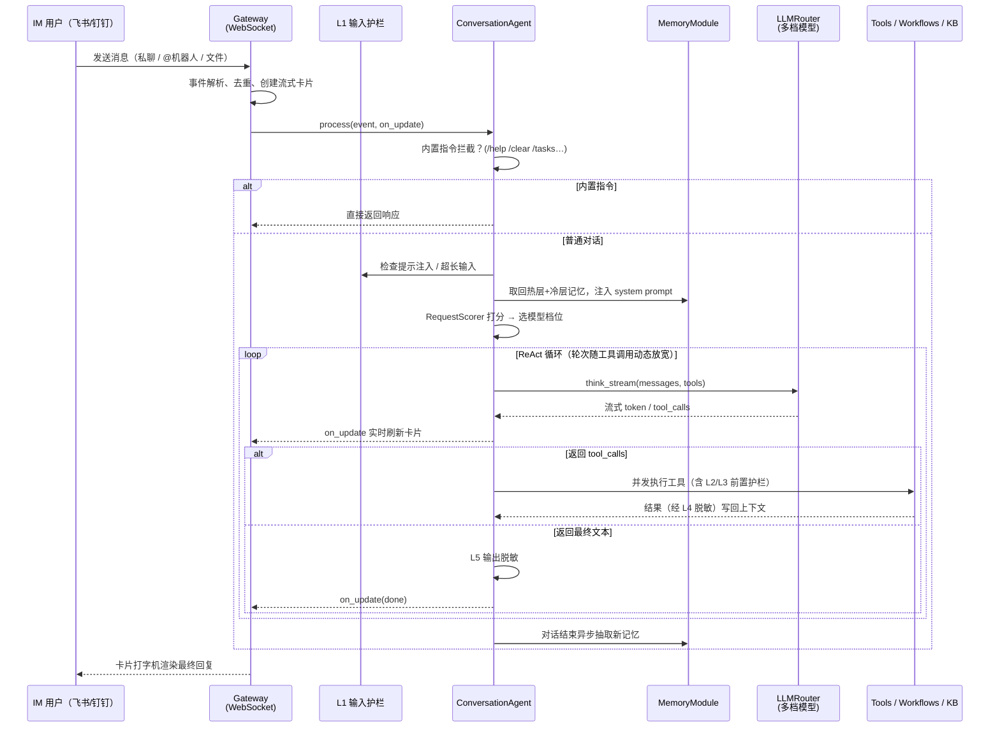
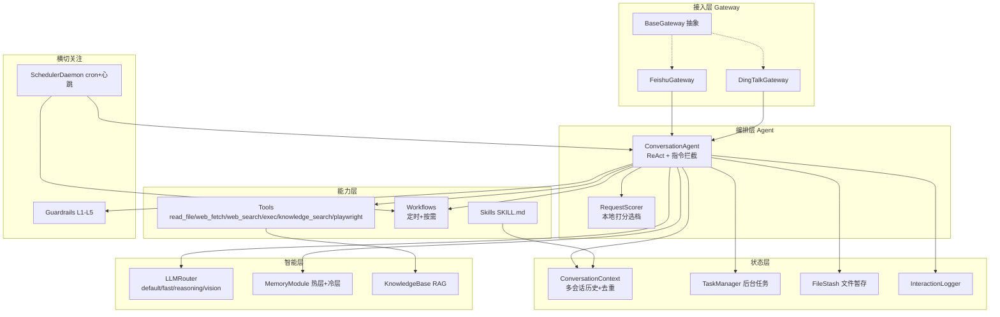

# PersonalAgent

> 一个把大语言模型「接到飞书 / 钉钉里」的个人 AI 助理：用户在 IM 里发一句话，它就能多轮对话、调用工具、跑业务流程、查内部知识库，并记住你的偏好——全部围绕一套统一的 Agent 内核运行。


---

## 一、这是什么 / 适用场景

PersonalAgent 是一个**常驻后台、多渠道接入的个人 AI 助理服务**。它通过 WebSocket 长连接挂在飞书、钉钉等 IM 上，把每一条用户消息交给一个统一的对话 Agent 处理；Agent 在一轮 ReAct 循环里自主决定是直接回答、调用工具（执行命令 / 抓网页 / 搜索 / 查知识库），还是触发一条预先编排好的业务工作流。

它适合下面这些场景：

- **个人 / 小团队的「IM 里的全能助手」**：不想为每件小事开网页、开 IDE，直接在飞书里问一句就能得到答案、跑脚本、拿到文件。
- **把重复的运营/数据任务做成「一句话触发」**：例如电商运营的补货预警、清货预警、滞销预警、成本更新等——既能定时自动跑，也能在 IM 里说「跑一下补货预警」按需触发，结果以 Excel 回传。
- **搭一个私有 RAG 知识库**：把 PDF / Word / Excel / 图片丢进 `knowledge_docs/sources/`，系统自动解析、分块、向量化入库；之后对话中需要时 Agent 自动检索，回答带出处。
- **需要「记得住人」的助理**：跨会话记住用户偏好、长期事实与近期事件，下次对话自动带上。
- **对安全有要求的环境**：内置五层护栏，拦截提示注入、危险命令、敏感路径读取，并对输出/工具结果做凭证脱敏，全程审计落盘。

> 核心定位：**一个 IM 入口 → 一个 Agent 内核 → 可插拔的工具 / 技能 / 工作流 / 知识库**。换 IM 平台不用动 Agent，加能力不用动平台。

---

## 二、核心能力一览

| 能力 | 说明 |
|------|------|
| **多渠道接入** | 飞书 + 钉钉并行运行，各自独立 daemon 线程；`config/channels.yaml` 一键开关。新增平台只需实现 `BaseGateway`。 |
| **统一对话内核** | `ConversationAgent` 跑 ReAct 循环：LLM 自主决定调用工具还是给出最终答案，按工具调用次数动态放宽轮次上限。 |
| **流式卡片 UI** | 飞书 CardKit 2.0 打字机渲染，标题实时反映「🤔 思考中 → 生成中 → ✅ 完成 / ❌ 出错」。 |
| **工具调用** | 内置 `read_file`、`web_fetch`、`web_search`、`exec`（前台/后台 Shell）、`knowledge_search`，以及通过 MCP 桥接的 Playwright 浏览器工具。 |
| **可扩展技能** | 在 `skills/*/SKILL.md` 放一份带 frontmatter 的说明即可热加载；元数据常驻 system prompt，完整流程按意图瞬态注入。 |
| **业务工作流** | `workflows/` 下每个子包声明 `WORKFLOW_META`，支持定时（cron）+ 按需（意图触发）两种执行方式，依赖按需自动安装。 |
| **跨会话记忆** | 双层记忆：热层（偏好+经验，始终注入）、冷层（情境+事件时间线）；对话后异步抽取，夜间自动合并。 |
| **私有知识库（RAG）** | 本地文件 → 解析 → 分块 → 可选 CoT 合成 → 向量化 → SQLite；检索走「子查询分解 + 关键词/向量混合 + RRF 融合 + LLM rerank」。 |
| **LLM 智能路由** | 一套 `LLMRouter` 管多档模型（主力 / 快速 / 推理 / 视觉）；`RequestScorer` 本地打分（<0.5ms）决定复杂请求是否升级到推理模型。 |
| **五层安全护栏** | L1 输入注入 / L2 危险命令 / L3 敏感路径 / L4 工具结果脱敏 / L5 输出脱敏，全部审计落盘。 |
| **定时与心跳** | `SchedulerDaemon` 跑 cron 任务（支持重启补跑）+ 心跳检测（LLM/飞书 API 探活）。 |

---

## 三、如何使用

### 1. 环境要求

- **Python 3.12**（见 `.python-version`）
- **uv** ≥ 0.4（[安装指引](https://docs.astral.sh/uv/getting-started/installation/)）
- 至少一个 **OpenAI 兼容的 LLM 服务**（DeepSeek / 通义千问 / 硅基流动 / OpenAI 等）
- 至少一个 **IM 平台凭证**：飞书自建应用 或 钉钉机器人

### 2. 安装

```bash
# 安装 uv（如未安装）
curl -LsSf https://astral.sh/uv/install.sh | sh

git clone <repo-url>
cd PersonalAgent

# 同步核心依赖（uv 自动创建 .venv）
uv sync
```

> 工作流和知识库的重依赖被拆成了**可选依赖组**，首次用到时自动安装，无需在初次安装时全部拉取。手动安装可用 `uv sync --group knowledge` / `--group costupdate-saihu` 等。

### 3. 配置 `.env`

在项目根目录创建 `.env`，最小可运行配置如下：

```dotenv
# ── LLM（必填）─────────────────────────────────────────────
LLM_MODEL_ID=deepseek-chat
LLM_API_KEY=your-api-key
LLM_BASE_URL=https://api.deepseek.com/v1
LLM_TIMEOUT=120

# ── 飞书（启用飞书时必填）──────────────────────────────────
FEISHU_APP_ID=your-app-id
FEISHU_APP_SECRET=your-app-secret

# ── 钉钉（启用钉钉时必填）──────────────────────────────────
DINGTALK_CLIENT_ID=your-client-id
DINGTALK_CLIENT_SECRET=your-client-secret
```

凭证只放 `.env`，**渠道开关在 `config/channels.yaml`**：

```yaml
channels:
  feishu:
    enabled: true
  dingtalk:
    enabled: true
```

> 完整的可选配置项（多档模型、路由策略、护栏阈值、知识库 embedding、流式渲染等）见下文 [配置参考](#六配置参考)。

飞书应用需开启 WebSocket 长连接及权限：`im:message`、`im:message:send_as_bot`、`cardkit:card`、`im:resource`（文件处理）。

### 4. 运行

```bash
uv run main.py
```

启动后进程常驻，多个 gateway 各自独立线程运行；任一线程异常退出主进程感知并退出。首次未检测到飞书凭证会自动进入交互式配置向导。

向机器人发送 `/help` 查看所有内置指令：

| 指令 | 说明 |
|------|------|
| `/help` | 列出所有内置指令 |
| `/clear` | 清空当前会话历史 |
| `/status` | 查看会话状态（会话 Key、历史条数等） |
| `/resume` | 列出历史会话；`/resume <序号>` 恢复指定会话 |
| `/export` | 导出当前会话完整记录（Markdown） |
| `/tasks` | 查看后台任务状态 |
| `/remember <内容>` | 主动写入一条记忆 |
| `/memories` | 查看当前用户的记忆 |

### 5. 灌入知识库（可选）

```bash
# 把文档放进 knowledge_docs/sources/ 下对应子目录后：
python -m personal_agent.knowledge ingest --all          # 全量入库
python -m personal_agent.knowledge ingest --path xxx.pdf # 单文件
python -m personal_agent.knowledge status                # 查看来源数 / chunk 数 / 缓存命中率
```

程序运行时还会有 `watchdog` 文件监听：往 `sources/` 丢文件，约 2 秒后自动入库。

---

## 四、业务架构（一条消息的旅程）



### 业务工作流（电商运营场景示例）

`workflows/` 下每个子包 = 一条可编排的业务流程，通过 `WORKFLOW_META` 声明元数据，`WorkflowRegistry` 启动时自动发现：

| 工作流 | 触发方式 | 作用 |
|--------|----------|------|
| `bhwarn_mabang` | 意图「补货预警」 | 从马帮 ERP 导出库存，筛选需补货 SKU，生成 Excel |
| `qhwarn_mabang` | 意图「清货预警」 | 筛选需清货 SKU 并出报告 |
| `zxwarn_mabang` | 意图「滞销预警」 | 筛选滞销 SKU 并出报告 |
| `costupdate_saihu` | 定时（每周一 10:00）| 更新赛狐平台商品成本，失败自动重试，结果推送飞书 |

定时类挂到 `SchedulerDaemon`；按需类由 Agent 识别意图后投递，产物通过 gateway 的 `send_file` 回传。

---

## 五、技术架构

### 分层视图



### 技术栈

| 分类 | 技术 | 用途 |
|------|------|------|
| 包管理 / 运行时 | uv + Python 3.12 | 依赖与虚拟环境 |
| LLM 接入 | openai SDK (≥2.32) | OpenAI 兼容 API，流式 + 工具调用 |
| 飞书 | lark-oapi (≥1.5.3) | WebSocket、CardKit 流式卡片、文件收发 |
| 钉钉 | dingtalk-stream (≥0.24) | Stream 模式长连接 |
| 调度 | APScheduler (≥3.10) | cron 定时 + 夜间记忆合并 + 持久化补跑 |
| 工具扩展 | mcp (≥1.27) | Playwright 等 MCP 工具桥接 |
| 网页 | requests + markdownify + ddgs | `web_fetch` / `web_search` |
| 知识库 | sqlite-vec + watchdog + markitdown + opendataloader-pdf + unstructured + paddleocr | RAG 解析、向量存储、文件监听 |
| 配置 | python-dotenv + pyyaml | `.env` + YAML 配置 |

### 核心逻辑要点

- **解耦三层**：Gateway 只懂平台协议，Agent 只懂业务，二者通过 `process(event, on_update)` 与回调注入解耦。`session_key` 用平台前缀（如 `dingtalk_`）隔离各渠道上下文。
- **ReAct 循环**：轮次上限由 `AGENT_MAX_TURNS_BASE` 起步，每次工具调用按 `AGENT_TURNS_PER_TOOL` 放宽，封顶 `AGENT_MAX_TURNS_HARD`，避免长链路被过早截断又防止失控。
- **LLM 路由**：`RequestScorer` 对请求做多维关键词打分（规划/数学/推理/代码/输出量/领域），按 `LLM_ROUTING_MODE`（economy/auto/quality/disabled）阈值决定是否升级到推理模型；纯本地、零额外 API。
- **记忆**：热层（`MEMORY.md`+`USER.md`，硬字符上限）始终注入；冷层（`context.md` Compiled Truth + `events.md` Timeline）记录情境与事件；对话后 `MemoryExtractor` 异步抽取并路由，`MemoryConsolidator` 达阈值或夜间把 Timeline 合并进 Compiled Truth。
- **知识库**：写路径解析→分块（512 token，重叠 64）→ 视情况两阶段 CoT 合成 wiki 页 → embedding（带 SQLite 缓存）→ 入库并记录血缘；读路径子查询分解→关键词+向量召回→RRF 融合→LLM rerank，详见 [`personal_agent/knowledge/SPEC.md`](personal_agent/knowledge/SPEC.md)。
- **护栏**：审计全部落盘 `logs/guardrail_audit.jsonl`，凭证命中只记指纹不记明文。

### 目录结构

```
PersonalAgent/
├── main.py                       # 启动入口：按依赖顺序初始化全部组件
├── pyproject.toml                # 依赖（含可选依赖组 / dependency-groups）
├── AGENTS.md                     # Agent「处理原则」，启动时注入 system prompt
├── prompts/system.md             # 外置行为规范，启动时注入
├── config/
│   ├── channels.yaml             # 渠道开关（飞书/钉钉）
│   └── scheduler.yaml            # 定时任务 + 心跳检测配置
├── knowledge_docs/               # 知识库：sources/ 原始文档、wiki/ CoT 页、kb.sqlite
├── memory_store/                 # 跨会话记忆落盘目录（按用户隔离）
├── artifact/                     # IM 上传文件落地目录
├── logs/                         # 交互日志 + 护栏审计
└── personal_agent/
    ├── agents/        # BaseAgent / ConversationAgent（ReAct + 指令）
    ├── gateway/       # BaseGateway / FeishuGateway / DingTalkGateway
    ├── context/       # ConversationContext（多会话历史 + 去重）
    ├── core/          # llm / llm_router / request_scorer / task_manager
    │                  #  / file_stash / interaction_logger / setup_wizard
    ├── tools/         # registry + 各工具（exec/read_file/web_*/knowledge/playwright）
    ├── skills/        # SKILL.md 声明式技能（热加载）
    ├── workflows/     # 业务工作流（定时 + 按需），base.py 定义 WorkflowMeta
    ├── memory/        # 热层/冷层记忆、抽取器、合并器、检索器
    ├── knowledge/     # RAG：parsers / chunker / cot / embedder / retriever / store / watcher
    ├── guardrails/    # 五层护栏 + 审计日志
    └── scheduler/     # cron 引擎 + 心跳引擎 + 持久化
```

---

## 六、配置参考

凭证一律放 `.env`；行为开关分布在 `config/*.yaml`。以下为 `.env` 全部可用变量（标 *可选* 的有默认值）。

### LLM 与路由

| 变量 | 说明 |
|------|------|
| `LLM_MODEL_ID` / `LLM_API_KEY` / `LLM_BASE_URL` | 主力模型（必填） |
| `LLM_TIMEOUT` | *可选* 请求超时秒数，默认 120 |
| `LLM_FAST_*` / `LLM_REASONING_*` / `LLM_VISION_*` | *可选* 快速/推理/视觉模型，Key/URL 缺省时复用主力 |
| `LLM_ROUTING_MODE` | *可选* `economy`/`auto`(默认)/`quality`/`disabled` |
| `LLM_ROUTING_THRESHOLD` | *可选* 手动覆盖路由阈值 |

### 渠道凭证

| 变量 | 说明 |
|------|------|
| `FEISHU_APP_ID` / `FEISHU_APP_SECRET` | 飞书应用凭证 |
| `FEISHU_MAX_WORKERS` | *可选* 消息并发线程数，默认 10 |
| `FEISHU_STREAM_PRINT_*` | *可选* 卡片打字机帧率/步长/策略 |
| `DINGTALK_CLIENT_ID` / `DINGTALK_CLIENT_SECRET` | 钉钉机器人凭证 |
| `DINGTALK_ALLOWED_USERS` | *可选* 白名单用户 ID（逗号分隔） |
| `DINGTALK_MAX_WORKERS` | *可选* 钉钉并发线程数 |

### Agent / 记忆 / 工具

| 变量 | 说明 |
|------|------|
| `AGENT_MAX_HISTORY` | *可选* 单会话滑动窗口条数，默认 20 |
| `AGENT_SYSTEM_PROMPT` | *可选* 追加自定义系统提示词 |
| `AGENT_MAX_TURNS_BASE` / `AGENT_TURNS_PER_TOOL` / `AGENT_MAX_TURNS_HARD` | *可选* ReAct 轮次控制 |
| `MEMORY_STORE_DIR` | *可选* 记忆落盘目录，默认 `memory_store` |
| `CARD_UPDATE_INTERVAL` / `STREAM_CHARS_PER_TICK` | *可选* 流式刷新节奏 |
| `EXEC_TIMEOUT` / `EXEC_ALLOWLIST` / `EXEC_ENCODING` | *可选* `exec` 工具超时/允许命令/编码 |
| `TAVILY_API_KEY` / `EXA_API_KEY` / `FIRECRAWL_API_KEY` | *可选* `web_search` 供应商 Key |

### 知识库 embedding

| 变量 | 说明 |
|------|------|
| `EMBED_MODEL_ID` / `EMBED_API_KEY` / `EMBED_BASE_URL` | embedding 模型配置 |
| `EMBED_DIM` / `EMBED_BATCH_SIZE` | *可选* 向量维度 / 批大小 |

### 护栏

| 变量 | 说明 |
|------|------|
| `GUARDRAIL_INPUT_ENABLED` / `GUARDRAIL_OUTPUT_ENABLED` | *可选* L1 / L5 总开关 |
| `GUARDRAIL_MAX_INPUT_CHARS` / `GUARDRAIL_MAX_OUTPUT_CHARS` | *可选* 长度上限 |
| `GUARDRAIL_EXEC_BLOCK_PKG_INSTALL` / `GUARDRAIL_BLOCKED_PATHS` | *可选* L2/L3 策略 |
| `GUARDRAIL_REDACT_PLACEHOLDER` / `GUARDRAIL_AUDIT_ENABLED` | *可选* 脱敏占位符 / 审计开关 |

`config/scheduler.yaml` 配置定时任务（5 字段 cron + 重启补跑）与心跳检测（支持 `${ENV_VAR}` 占位符）；`AGENTS.md` 的「处理原则」章节启动时自动注入提示词。

---

## 七、扩展开发

### 新增一个 Tool

在 `personal_agent/tools/` 写一个返回 `ToolDef` 的工厂函数，然后在 `registry.py` 的 `get_all_tools()` 列表末尾追加一行即可，重启后对 LLM 自动可见：

```python
# personal_agent/tools/my_tool.py
from .types import ToolDef

def build_my_tool() -> ToolDef:
    def my_call(param: str, **kwargs) -> str:
        return f"结果：{param}"
    return ToolDef(
        name="my_tool",
        description="工具用途描述，LLM 据此决定何时调用",
        parameters={
            "type": "object",
            "properties": {"param": {"type": "string", "description": "参数说明"}},
            "required": ["param"],
            "additionalProperties": False,
        },
        call=my_call,
    )
```

### 新增一个 Skill

在 `personal_agent/skills/<name>/SKILL.md` 写带 frontmatter 的说明（`name` / `description` + 工作流正文），脚本放同目录 `scripts/`。启动时自动扫描：元数据进 system prompt，正文按意图瞬态注入；脚本的**绝对路径**会自动注入，LLM 调 `exec` 时无需猜路径。无需改任何 Python 代码。

### 新增一个 Workflow

在 `personal_agent/workflows/<name>/__init__.py` 声明 `WORKFLOW_META = WorkflowMeta(...)`：填 `schedule`（cron）即为定时任务，填 `intent_triggers` 即为按需任务。重依赖写进 `pyproject.toml` 的 `[dependency-groups]`，首次运行自动安装。

### 修改 Prompt

| 位置 | 用途 |
|------|------|
| `ConversationContext._BASE_SYSTEM_PROMPT` | 最底层身份与格式约束 |
| `AGENTS.md` →「处理原则」 | 推荐改这里，启动自动注入，无需改代码 |
| `prompts/system.md` | 外置行为规范文件 |
| `.env` → `AGENT_SYSTEM_PROMPT` | 动态追加 |

---

## 八、设计权衡（FAQ）

- **为什么凭证和开关分开？** 凭证（敏感）只进 `.env` 不入库；开关（非敏感）进 YAML 便于版本管理与 review。
- **为什么用本地打分而不是让 LLM 自己选模型？** 路由是确定性问题，本地关键词打分 <0.5ms、零成本、可观测可调阈值，比再调一次 LLM 更合适（见 `AGENTS.md` 处理原则）。
- **知识库为什么自己造而不用现成向量库？** 单文件 SQLite + sqlite-vec 零运维、易随项目分发；混合检索 + LLM rerank 在中文召回上比纯向量更稳。设计细节见 `personal_agent/knowledge/SPEC.md`。
